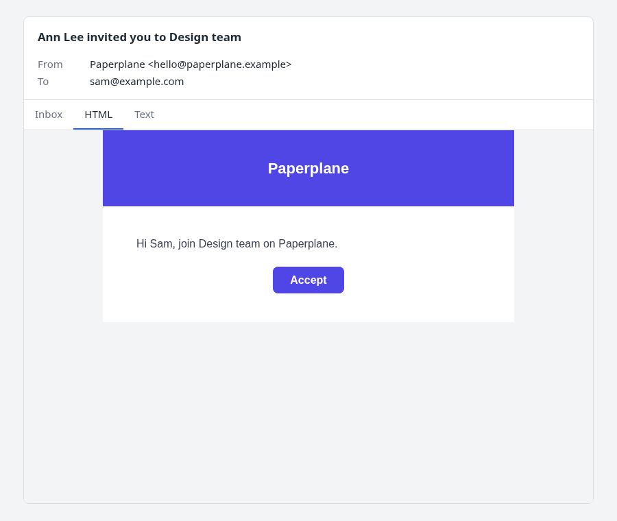

# django-mjml-templates

Write email as `.mjml` templates, render and send them from a normal Django view. No Node, no
new template engine: it's Django's template backend with `.mjml` files compiled to email HTML,
and a plain-text part made for you.

## Setup

```python
# settings.py
TEMPLATES = [{
    "BACKEND": "mjml_templates.django.DjangoTemplates",  # was django.template.backends.django.DjangoTemplates
    ...
}]
```

Only templates ending in `.mjml` are treated as email; everything else renders as before.

## The template

```html
{# templates/email/invite.mjml #}
<mjml>
  <mj-head><mj-title>{{ inviter.get_full_name }} invited you to {{ team.name }}</mj-title></mj-head>
  <mj-body>
    <mj-section><mj-column>
      <mj-text>Hi {{ invite.name }}, join {{ team.name }} on Example.</mj-text>
      <mj-button href="">Accept</mj-button>
    </mj-column></mj-section>
  </mj-body>
</mjml>
```

A Django template first (``, ``, autoescaping), then MJML. `<mj-title>` is
the subject.

## The view

```python
from django.shortcuts import get_object_or_404, redirect
from django.template.loader import get_template


def send_invite(request, team_id):
    team = get_object_or_404(Team, pk=team_id, owner=request.user)
    invite = Invite.objects.create(team=team, email=request.POST["email"])

    message = get_template("email/invite.mjml").render_email(
        {"invite": invite, "team": team, "inviter": request.user},
        request,                      # absolute URLs come from the request
        to=[invite.email],
    )
    message.send()
    return redirect("team", team.pk)
```

`render_email` gives back a Django `EmailMultiAlternatives`: subject from `<mj-title>`, HTML
from the MJML, plain text generated from it. Attach files, set `reply_to`, or send it in a
Celery task like any other Django message.

## Looking at it before it goes

Another view returns the same message as a page: an inbox row, the HTML and the text.

```python
from django.contrib.admin.views.decorators import staff_member_required
from mjml_templates.preview import preview_response


@staff_member_required
def invite_preview(request):
    message = get_template("email/invite.mjml").render_email(
        {"invite": sample_invite(), "team": sample_team(), "inviter": request.user}, request
    )
    return preview_response(message)
```

{ width=480 }

## Where next

**How-to**

- [Build a simple design](how-to/build-a-design.md): a base template with the look, and emails that fill it
- [Write a shared layout](how-to/write-a-layout.md): ``, the subject, a hand-written `.txt`
- [Send from a task or command](how-to/send-from-a-task.md): Celery, attachments, one email per recipient
- [Test an email](how-to/test-an-email.md): `mail.outbox` and `render_email_parts`
- [Make links absolute](how-to/absolute-urls.md): tasks, commands and `MJML_BASE_URL`
- [Preview an email](how-to/preview-an-email.md): a page, or a fragment in your own
- [Customise the preview](how-to/customise-preview.md): colours, dark mode, markup

**Reference**

- [API](reference/api.md): `render_email`, `render_email_parts`, the subject, URL rules, settings
- [The plain-text fallback](reference/plain-text.md): how each construct comes out as text
- [Preview](reference/preview.md): arguments, tabs, properties, blocks, safety

**Explanation**

- [Why this](explanation/why.md)
- [How a render works](explanation/how-a-render-works.md): the steps, and what their order means
- [How the preview is designed](explanation/preview-design.md): why it is a function, and the safety choices
