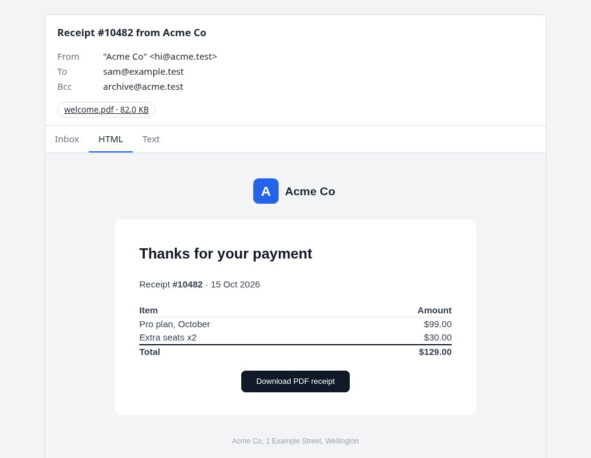
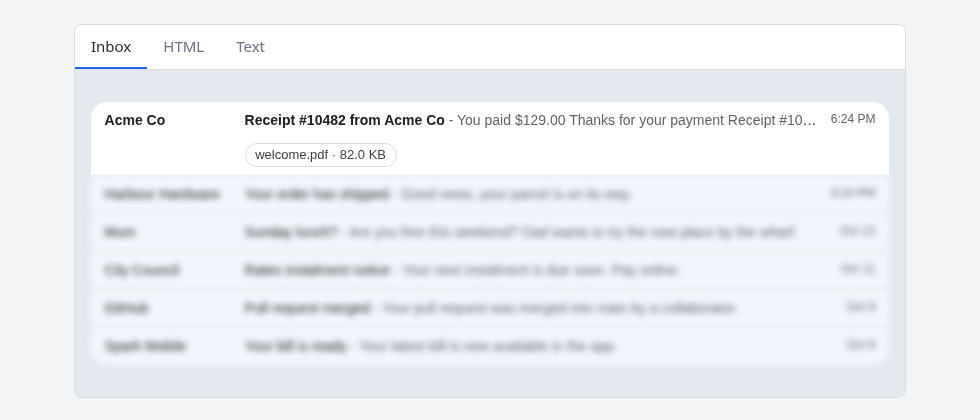

# Previewing an email



`preview_response` renders a page that shows an email the way a person would meet it: a row in
an inbox, the HTML part, and the plain-text part. It reads everything from the Django message
you give it, so what you see is what `.send()` would send.

To put the preview inside a page of your own (an admin screen, a template editor), use
`preview_fragment` instead. It returns the same thing as embeddable, scoped markup; see
[Embedding](#embedding-in-your-own-page).

Nothing is wired up for you: no URL, no setting, no `INSTALLED_APPS` entry. Your own view builds
the message, decides who may see it, and returns the response.

```python
from django.contrib.admin.views.decorators import staff_member_required
from django.template.loader import get_template

from mjml_templates.preview import preview_response


@staff_member_required
def welcome_preview(request):
    message = get_template("email/welcome.mjml").render_email(
        {"user": request.user}, request, to=[request.user.email]
    )
    return preview_response(message)
```

It works for any Django `EmailMessage` or `EmailMultiAlternatives`, not only ones from this package.

## What the page shows

- **The envelope:** the subject, From, To, Bcc and the attachments, above the tabs.
- **Inbox:** your message as the first row of a mock inbox (sender, subject, then the
  `<mj-preview>` and the body's own words, as a mail client runs them together), with a few
  placeholder messages beneath it.
- **HTML:** the HTML part in a sandboxed frame with scripts off.
- **Text:** the plain-text part.

The tabs are always in that order (Inbox, HTML, Text), minus any the message has nothing for.



## Arguments

```python
preview_response(message, *, heading="", **options)

preview_fragment(
    message, *, attachment_urls=None, inbox=True,
    tab=None, tabs=None, links=False, css="",
    template="mjml_templates/preview_fragment.html", context=None,
)
```

`preview_response` takes `heading` and passes every other option to `preview_fragment`, so the
table below covers both.

| Argument | Default | Meaning |
|---|---|---|
| `message` | required | The email. A `ValueError` if it has neither an HTML nor a text body. |
| `heading` | `""` | A page heading (`preview_response` only). There is none unless you give one. |
| `attachment_urls` | `None` | `{filename: url}` to link an attachment's chip. |
| `inbox` | `True` | `True` for placeholder rows, a list of your own, or falsey for no Inbox tab. |
| `tab` | `None` | The tab that is open. `None` is the first. |
| `tabs` | `None` | Which tabs to offer. `None` is all of them. |
| `links` | `False` | Make links live. See [Links](#links). |
| `css` | `""` | Extra CSS, after the page's own. See [Restyling](#restyling). |
| `template` | the packaged one | Your own template that extends the fragment. See [Your own stylesheet or markup](#your-own-stylesheet-or-markup). |
| `context` | `None` | Extra variables for that template. |

### Tabs

`tab` chooses the open one (`"inbox"`, `"html"` or `"text"`). If the message has no such tab it
falls back to the message's own content (HTML, then Text) before the Inbox mock.

`tabs` limits which are offered, and never changes their order. An `"html"` the message lacks
becomes its `"text"`, so `tabs=("inbox", "html")` still gives a plain-text email a way in:

```python
preview_response(message, tabs=("html", "text"))   # no Inbox
preview_response(message, tabs=("inbox",))         # only the Inbox: its row goes nowhere
preview_response(message, tabs=())                 # no tab row: just the open view
```

With one tab left the tab row is not shown. Clicking your message's row in the Inbox switches to
the HTML view (or Text, when there is no HTML), if that tab is on the page.

### The inbox

`inbox=True` fills the tab with a few generic rows, dated back from now so they never look stale.
Pass your own as `(sender, subject, snippet, when)` tuples:

```python
preview_response(message, inbox=[("Mum", "Sunday lunch?", "Are you free this weekend?", "Oct 12")])
```

Your message is always the first row. Anything falsey (`False`, `None`, `()`) turns the Inbox tab
off. The generated placeholder rows are blurred and can't be selected, so the eye stays on your
message; rows you pass yourself are shown plainly.

### Attachments

An attachment shows as a chip with its name, type (on hover) and size. The file's content is not
in the page. To link a chip, say where the file lives:

```python
preview_response(message, attachment_urls={"invoice.pdf": reverse("invoice_pdf", args=[invoice.pk])})
```

Only `/`, `http://` and `https://` URLs are linked. The chips are plain text in the Inbox row.

### Links

Links are dead by default: a click does nothing and hovering shows where the link points. A
preview should not be able to confirm an address or spend a one-time token.

`links=True` makes them live, opening in a new tab, and linkifies URLs in the text part. This
loosens the frame's sandbox to allow popups (scripts stay off). Only the displayed copy is
changed, never the message.

## Embedding in your own page

`preview_fragment(message, **options)` returns a `SafeString` of markup you drop into a template:

```python
from mjml_templates.preview import preview_fragment

def template_editor(request, pk):
    message = ...
    return render(request, "editor.html", {"preview": preview_fragment(message, tab="html")})
```

```html
<div class="my-panel">{{ preview }}</div>
```

It is a single `<div class="mjml-preview">` with its own `<style>` scoped under that class, and
class names are prefixed `mp-`, so it won't restyle your page. Ids and the tab radio group carry a
per-call suffix, so several previews can share a page. The fragment has no `<html>` or `<head>`;
the email itself stays in a sandboxed `srcdoc` frame.

The fragment follows your page's custom properties (below): set `--mjml-*` on any ancestor, or
leave them and it uses its own defaults. It does not set a page background; `--mjml-bg` only
applies to `preview_response`'s page.

## Restyling

Both are styled with CSS custom properties, so a brand colour or font is one block of `css=`
(for the fragment, you can also set them in your own stylesheet; your values win over the defaults):

```python
preview_response(message, css=":root { --mjml-accent: #c026d3; --mjml-font: Georgia, serif; }")
```

| Property | Default (light) | What it sets |
|---|---|---|
| `--mjml-font` | `system-ui, sans-serif` | The page's font |
| `--mjml-bg` | `#f3f4f6` | Page background |
| `--mjml-text` | `#1f2933` | Body text, the open tab, and links in the text part |
| `--mjml-muted` | `#6b7280` | Labels and inactive tabs |
| `--mjml-card` | `#fff` | The card |
| `--mjml-border` | `#d9dce1` | Borders |
| `--mjml-accent` | `#2563eb` | The open tab's underline and focus ring |
| `--mjml-radius` | `.5rem` | The card's corners |

The inbox mock keeps its own light look in both colour schemes, since it imitates a mail client.

### Dark mode

`preview_response`'s page redefines the colour properties under `prefers-color-scheme: dark` (all
but the font, accent and radius), since the page owns its background. `preview_fragment` does not:
it uses whatever your page sets, so it never turns light-on-light inside a host that is not dark.
If you change one of those colours on the page, set a dark value too; the accent keeps its light
value unless you give it one:

```python
css = """
:root { --mjml-accent: #7c3aed; }
@media (prefers-color-scheme: dark) { :root { --mjml-accent: #a78bfa; } }
"""
```

### Your own stylesheet or markup

`preview_response` is its own HTML document, so your site's stylesheets are not loaded on it;
pass the rules as `css=`, or read them from a file: `css=Path("static/brand.css").read_text()`.
(`preview_fragment` lives in your page, so your stylesheets already apply.)

There are two templates, and each can be overridden by one of the same name in your own
templates directory:

| Template | Is | Blocks |
|---|---|---|
| `mjml_templates/preview_fragment.html` | The preview itself (what `preview_fragment` renders, and the page includes) | none |
| `mjml_templates/preview.html` | The page that `preview_response` wraps it in | `head` (after the built-in styles), `content` |

To change part of the preview rather than all of it, name your own template and extend the
fragment, filling only the blocks you want. `context=` adds variables for it (the preview's own
win over a clashing key), and `message`, `from_addr` and the rest of the fragment's variables
are there too:

```python
preview_fragment(message, template="billing/email_preview_fragment.html", context={"note": "Nothing is sent"})
```

```html

<span class="mp-aside">{{ note }}</span>
```

| Block | Holds |
|---|---|
| `style` | Extra `<style>`, after the built-in rules and before `css=` |
| `envelope` | Subject, From, To, Bcc and attachment chips (empty it to drop them) |
| `tab_label` | One tab's label text (`tab` is `inbox`, `html` or `text`), e.g. `Plain text{{ block.super }}` |
| `tab_aside` | At the end of the tab bar (`.mp-bar`, with the labels); `mp-aside` pushes it to the right |
| `panel_html` | The HTML part's frame |
| `panel_text` | The text part |
| `inbox_row` | Your message's row in the Inbox |
| `inbox_others` | The other rows: the placeholders, or your own `inbox=` list |

The blocks sit inside the panels, which keep their `mp-` classes, so the tab switching still
works however much you replace. Replacing `panel_html` is where you take responsibility for the
frame's `sandbox`: the stock one has scripts off, so a message cannot run code, which is also
what a mail client does. If you need scripts (a script of your own that talks to your page, say),
write the `<iframe sandbox="allow-scripts …">` yourself here, and never add `allow-same-origin`
alongside it. Extending needs `"mjml_templates"`
in `INSTALLED_APPS` (below).

The packaged template is always the fallback, with nothing to install. To
`` instead of copying it, add `"mjml_templates"` to
`INSTALLED_APPS` so your engine can find the parent. Without that, an extending override raises
`TemplateDoesNotExist` rather than quietly showing the stock page.

## Safety

- The email's HTML is never marked safe. It is escaped into the frame's `srcdoc`, and the frame
  has `sandbox` with scripts off, and never `allow-same-origin`.
- The text part is escaped; with `links=True` it is escaped first and then linkified.
- `css=` is written into the page unescaped, on purpose. It must come from your code, never from a
  message or from user input.
- The page does not check who is looking. Put the view behind your own permission check, and
  remember that with `links=True` a click is a real request: one-time links in the email work.

## Not included

- No URL, view or admin page. The preview is a function you call.
- No sending or resending, and no recipient picking: it shows a message you've already built.
- No fidelity claim about any one mail client. The Inbox tab is a plausible inbox row, not
  a Gmail or Apple Mail screenshot.
